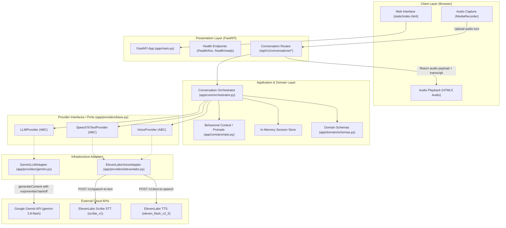

# Architecture & Implementation Status (Arch 0)

> **Document:** `arch0.md`  
> **Status:** Current Working System (Phase 0 & Phase 1 MVP)  
> **System Scope:** Speech-to-Speech (S2S) Voice Assistant inspired by *Her* (Samantha)  
> **Architecture Pattern:** Modular Monolith with Ports & Adapters (Hexagonal Architecture)

---

## 1. Executive Summary

This architecture documents the functioning implementation built across Phase 0 and Phase 1. 

The system operates as an end-to-end **Speech-to-Speech (S2S)** pipeline:
1. The user captures audio in the browser via standard MediaRecorder APIs.
2. Raw audio streams are ingested by the FastAPI backend.
3. Audio is transcribed via ElevenLabs' `scribe_v1` Speech-to-Text (STT) model.
4. The transcript is processed by the **Conversation Orchestrator** which injects behavioral guidelines (`SKILL.md`) and conversational context into Google's **Gemini 3.8 Flash** model.
5. The generated textual response is synthesized into low-latency voice audio via ElevenLabs' **`eleven_flash_v2_5`** model using voice ID `EXAVITQu4vr4xnSDxMaL` (Bella).
6. The synthesized audio bytes are base64-encoded and streamed back to the browser for immediate playback.

---

## 2. High-Level System Architecture Diagram

---

## 3. End-to-End Speech-to-Speech Sequence Flow

```mermaid
sequenceDiagram
    autonumber
    actor User
    participant Browser as Browser Client
    participant API as FastAPI Router
    participant Orch as Conversation Orchestrator
    participant ElevenSTT as ElevenLabs Scribe (STT)
    participant Gemini as Gemini 3.8 Flash (LLM)
    participant ElevenTTS as ElevenLabs Flash (TTS)

    User->>Browser: Taps microphone and speaks
    User->>Browser: Taps mic button when finished
    Browser->>API: POST /api/v1/conversations/{id}/audio-turns (multipart/form-data)
    API->>Orch: execute_audio_turn(conversation_id, audio_bytes)
    
    rect rgb(30, 40, 50)
        Note over Orch,ElevenSTT: Step 1: Speech-to-Text Transcription
        Orch->>ElevenSTT: transcribe_audio(audio_bytes, model="scribe_v1")
        ElevenSTT-->>Orch: "Hello, Samantha. What is your favorite thing about conversations?"
    end

    rect rgb(45, 35, 45)
        Note over Orch,Gemini: Step 2: Context Assembly & LLM Reasoning
        Orch->>Orch: Append user message to session context
        Orch->>Gemini: generate_response(context_messages, system_prompt=SKILL.md)
        Gemini-->>Orch: "I think it’s the unpredictability. Even though I'm an AI..."
        Orch->>Orch: Append assistant message to session context
    end

    rect rgb(30, 50, 40)
        Note over Orch,ElevenTTS: Step 3: Low-Latency Speech Synthesis
        Orch->>ElevenTTS: synthesize_speech(text, voice="Bella", model="eleven_flash_v2_5")
        ElevenTTS-->>Orch: binary MP3 audio bytes
    end

    Orch->>API: TurnResponse (transcript, text, base64 audio payload)
    API-->>Browser: JSON HTTP 200 Response
    Browser->>User: Renders text transcript & plays audio response
```

---

## 4. Component Inventory & Responsibilities

| Component | Path | Responsibility |
|---|---|---|
| **Configuration** | `app/core/config.py` | Validated environment parameters from `.env` using Pydantic Settings. |
| **System Persona** | `app/core/prompts.py` | Encapsulates the Samantha operating guidelines derived from `SKILL.md`. |
| **Turn Orchestrator** | `app/core/orchestrator.py` | Coordinates the turn lifecycle: STT → Context Assembly → LLM → TTS → Session updates. |
| **Domain Contracts** | `app/domain/schemas.py` | Pydantic data schemas: `Message`, `TurnRequest`, `TurnResponse`, `AudioInfo`, `TurnStatus`. |
| **Ports (Abstract)** | `app/providers/base.py` | Abstract interfaces: `LLMProvider`, `VoiceProvider`, and `SpeechToTextProvider`. |
| **Gemini Adapter** | `app/providers/gemini.py` | Async HTTP client for Google Generative AI API with exponential backoff on 429/503 spikes. |
| **ElevenLabs Adapter** | `app/providers/elevenlabs.py` | Async client for ElevenLabs TTS (`eleven_flash_v2_5`) and STT (`scribe_v1`). |
| **API Endpoints** | `app/api/conversations.py` | REST routes: conversation session creation, text turn execution, audio turn execution. |
| **Web Entrypoint** | `app/main.py` | FastAPI application, health checks (`/health/live`, `/health/ready`), static mount. |
| **Frontend UI** | `static/index.html` | Client interface with HTML5 `MediaRecorder` audio capture, playback, and text fallback. |
| **Test Suite** | `tests/` | Automated unit tests and provider mocks (`tests/mocks.py`, `tests/test_conversations.py`). |

---

## 5. Security & Isolation Safeguards

1. **Zero Secret Leakage:**
   - Provider API keys (`GEMINI_API_KEY`, `ELEVENLABS_API_KEY`) reside strictly server-side in `.env`.
   - `.env` is verified git-ignored. A placeholder template [`docs/.env.example`](file:///home/a9rmx_1990/crack/her/.env.example) is maintained for reference.
   - Frontend JavaScript does not receive or transmit third-party API credentials.
2. **Graceful Provider Degradation:**
   - If TTS audio synthesis encounters an error, the textual response is preserved and delivered to the user rather than failing the turn.
   - Transient model spikes (503 / 429) trigger automatic retries with exponential backoff.
3. **Decoupled Architecture:**
   - Neither the web layer nor the orchestration logic is coupled to specific cloud vendors.
   - Swapping LLM (e.g., to Anthropic, OpenAI, or local Ollama) or Voice (e.g., to Whisper, Deepgram, or Cartesia) only requires implementing a concrete adapter for the corresponding port in `app/providers/base.py`.

---

## 6. What Remains for Subsequent Phases

- **Phase 2:** WebSocket streaming for real-time word-by-word streaming and audio chunk playback.
- **Phase 3:** Persistent PostgreSQL database schema (`users`, `conversations`, `memories`) and semantic memory retrieval via `pgvector`.
- **Phase 4:** Computational affect engine (bounded state updates for valence, arousal, curiosity, and uncertainty).
- **Phase 5:** Permissioned tool execution gateway with confirmation prompts for consequential actions.
