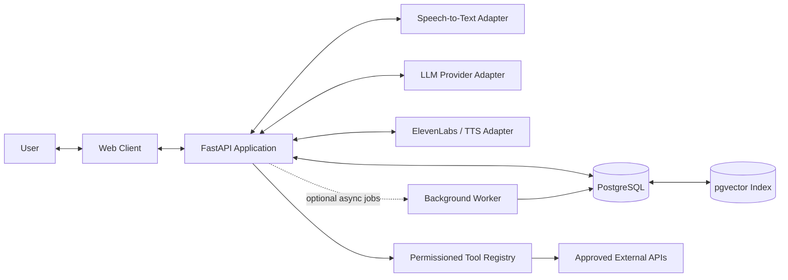
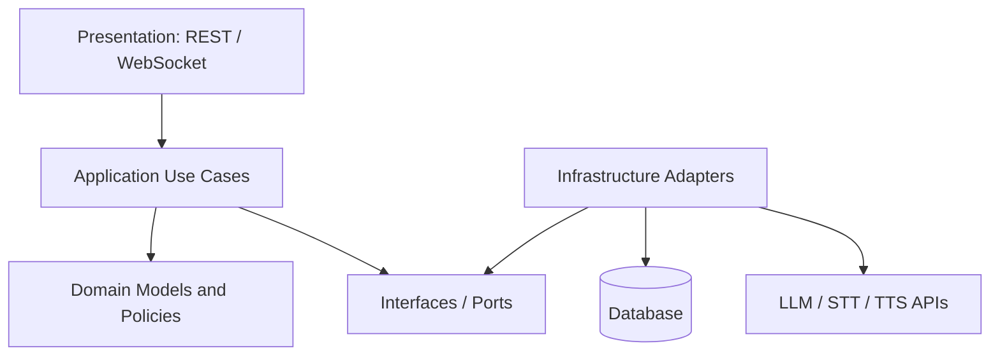
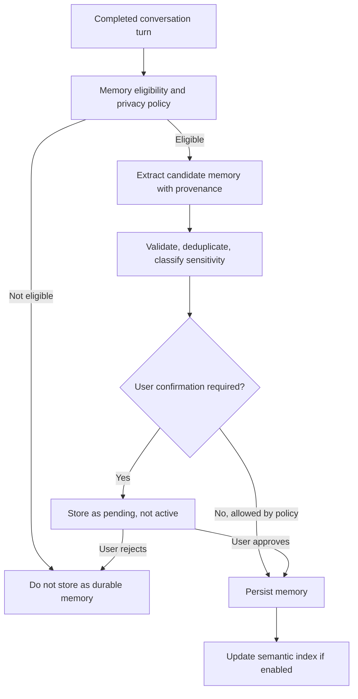
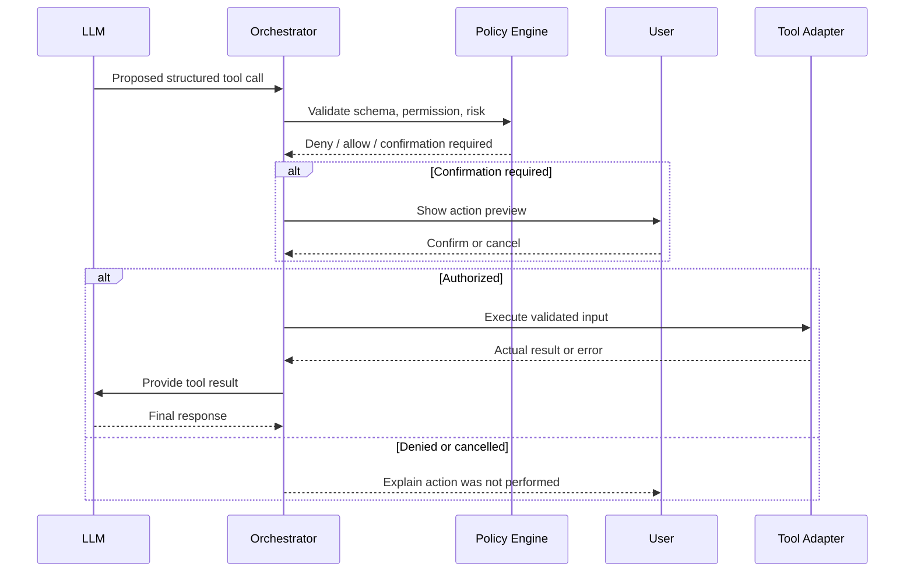
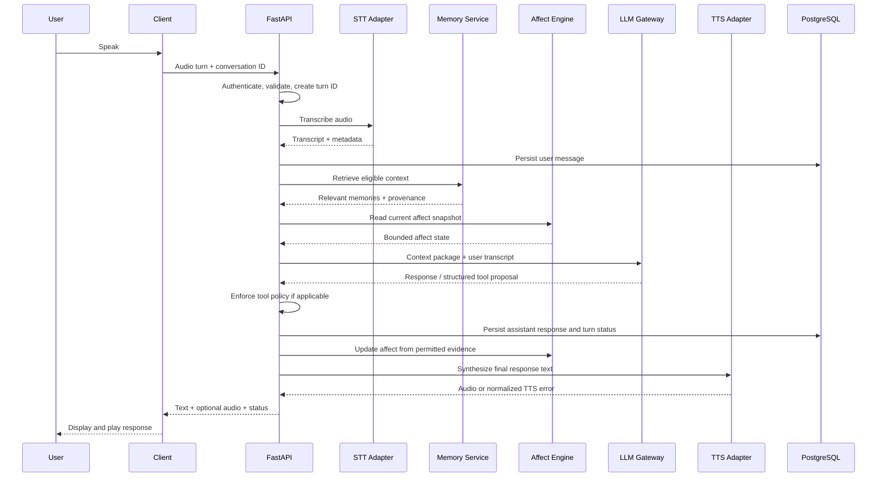
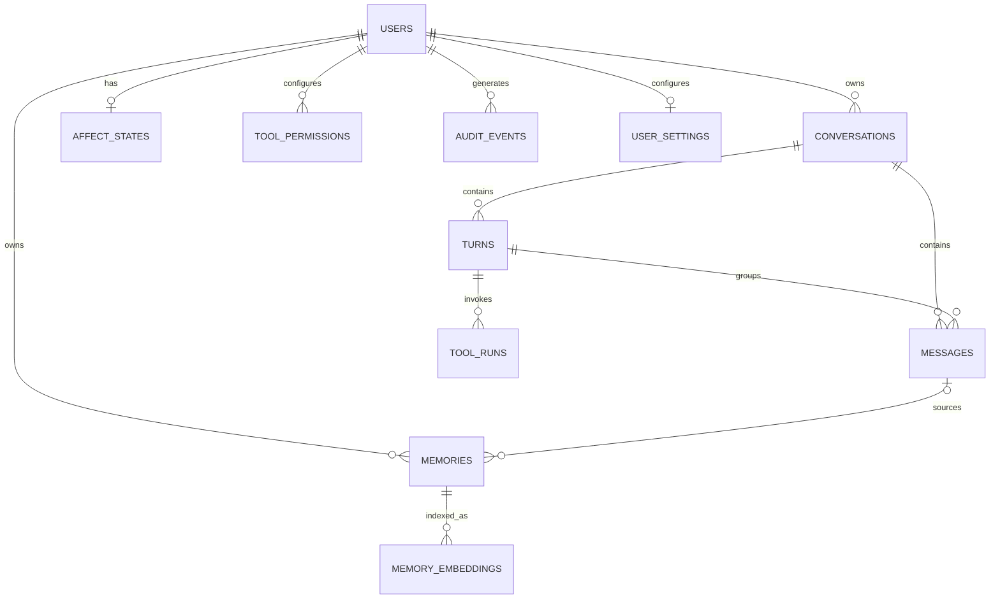

# Architecture — Samantha-Inspired Personal AI Assistant

> **Status:** Proposed reference architecture  
> **Version:** 1.0  
> **Purpose:** Define the system boundaries, components, data flows, interfaces, storage model, safety controls, and implementation sequence for a voice-first personal AI assistant inspired by the conversational experience in *Her*.  
> **Important:** This is a design specification, not evidence that any component has already been implemented or verified against a live provider API.

---

## 1. Executive summary

The project is a **voice-first personal AI assistant** designed to hold natural conversations, remember user-approved information over time, adapt its communication style to conversational context, use tools when explicitly permitted, and speak through a natural voice.

The architecture should make the assistant feel continuous without pretending that it is conscious or that its simulated emotional state proves it has subjective feelings. Its continuity comes from explicit state, reliable memory, consistent persona instructions, and controlled access to tools—not from an opaque, ever-growing prompt.

The first implementation should be a **modular monolith** rather than a fleet of microservices. One FastAPI backend owns the conversation lifecycle and calls clearly separated internal modules. PostgreSQL is the source of truth for durable application data; `pgvector` is an optional semantic-retrieval index. ElevenLabs is the initial voice provider behind a replaceable adapter. The LLM provider is also abstracted so that cloud, local, or hybrid inference can be chosen without redesigning the application.

### Primary design decisions

| Concern | Initial decision | Reason |
|---|---|---|
| Application shape | Modular monolith | Easier to develop, test, and deploy as a solo project |
| Backend | Python + FastAPI | Async I/O, typed schemas, strong Python AI ecosystem |
| Client | Web client first; desktop/mobile later | Fastest way to validate the voice interaction loop |
| Speech output | ElevenLabs adapter | User already has ElevenLabs API access |
| Speech input | Provider adapter; choose after checking account/API support | Keeps transcription replaceable |
| LLM | Provider-neutral interface | Avoids coupling memory, tools, and prompts to one model |
| Durable storage | PostgreSQL, optionally hosted by Supabase | Transactions, relational integrity, mature ecosystem |
| Semantic memory | `pgvector` after basic memory works | Semantic retrieval without introducing a separate vector database |
| Short-lived state | In-process initially; Redis only when needed | Avoid premature infrastructure |
| Background work | Simple async tasks first; queue later | Keeps MVP understandable |
| Authentication | Single-user local mode first; real authentication before remote multi-user exposure | Avoids unnecessary complexity while preserving a secure path |
| Observability | Structured logs, request IDs, latency and error metrics | Makes failures measurable instead of guessed |
| Safety model | Explicit tool permissions, confirmation for consequential actions, audit trail | Prevents an LLM from silently taking arbitrary actions |

These are **proposed defaults**, not immutable requirements. Provider-specific details must be verified against current official documentation before implementation.

---

## 2. Product goals and non-goals

### 2.1 Goals

1. Support natural voice conversations with low perceived latency.
2. Handle text input and text responses as a fallback.
3. Maintain conversation context within a session.
4. Store durable memories only under clear memory policies.
5. Retrieve relevant memories with provenance and confidence.
6. Maintain a bounded computational-affect state to influence response tone—not to claim consciousness.
7. Use a controlled set of tools such as time lookup, notes, reminders, or user-approved integrations.
8. Recover gracefully from speech, model, database, and network failures.
9. Keep provider credentials and privileged operations on the backend.
10. Make components independently testable and replaceable.

### 2.2 Non-goals for the first release

- A claim of genuine consciousness, sentience, or human-like subjective emotion.
- Unrestricted autonomous access to the user's computer, files, accounts, microphone, camera, or network.
- Always-on microphone recording by default.
- Training a foundation model from scratch.
- A distributed microservice platform, Kubernetes, or a complex event bus before scale requires them.
- Fully autonomous high-impact actions such as sending messages, spending money, deleting files, or changing account security without a specific authorization and confirmation flow.
- Guaranteed factual correctness. The architecture reduces unsupported claims but cannot eliminate model errors.

### 2.3 Acceptance criteria for the first useful milestone

- User can submit text or record a voice turn.
- Speech input is converted to text by the selected transcription path.
- The backend creates a traceable turn, assembles bounded context, calls the configured LLM, and returns a response.
- The response can be synthesized into speech by ElevenLabs or the selected voice provider.
- Conversation history is persisted without storing raw audio unless explicitly enabled.
- Memory retrieval can be disabled and still leave ordinary conversation functional.
- Secrets are never sent to the browser or committed to source control.
- Tests cover the main turn lifecycle, permission checks, memory boundaries, and provider failures.
- The application can honestly report when a tool or provider failed.

---

## 3. System context

### 3.1 Actors and external systems

- **User:** speaks or types, hears responses, reviews and manages stored memories, and grants permissions.
- **Web client:** microphone controls, recording state, transcript display, audio playback, text fallback, and settings.
- **FastAPI application:** coordinates a complete conversation turn and enforces application policy.
- **Speech-to-text provider:** converts user audio to text. Exact provider and API mode are a configuration decision.
- **ElevenLabs text-to-speech provider:** synthesizes assistant text into audio.
- **LLM provider:** produces the assistant's response and, where supported, structured tool-call proposals.
- **PostgreSQL/Supabase:** stores users, conversations, messages, memories, affect snapshots, tool permissions, and audit records.
- **Optional Redis/worker:** later handles jobs that should not block a conversation request.
- **External tools:** narrowly scoped integrations added only when the user explicitly enables them.

### 3.2 System context diagram



The browser communicates with the application backend. Provider API keys and privileged tool credentials remain server-side. The client must not call the LLM or ElevenLabs with a secret embedded in frontend code.

---

## 4. Architectural style and dependency rules

Use a **modular monolith with clean/hexagonal boundaries**.

- **Presentation layer:** HTTP/WebSocket endpoints and client-facing schemas.
- **Application layer:** use cases and orchestration of a conversation turn.
- **Domain layer:** conversation, memory, affect, permission, and tool-execution rules.
- **Infrastructure layer:** database repositories, LLM/STT/TTS providers, logging, and external API adapters.

### 4.1 Dependency direction



The domain and application layers must not import provider SDKs directly. Provider SDKs belong in infrastructure adapters. Endpoints should validate input and call a use case; they should not contain memory retrieval, prompt construction, or tool policy logic.

### 4.2 Why not microservices yet?

The first version has one primary developer, one user experience, and a small number of integrations. A modular monolith allows clean separation without network hops, distributed transactions, deployment overhead, or unnecessary operational complexity. A module can be extracted later only when scale, reliability, security isolation, or team ownership justifies it.

---

## 5. Recommended technology stack

| Layer | Proposed technology | Notes |
|---|---|---|
| Client | TypeScript + React or a lightweight web UI | Keep audio capture and playback in the client |
| API | Python 3.11+ and FastAPI | Pin a supported version after environment validation |
| Validation | Pydantic | Validate request and provider response shapes |
| Database | PostgreSQL | Primary durable source of truth |
| Database hosting | Supabase is a practical option | Can start with local PostgreSQL if preferred |
| Semantic search | PostgreSQL `pgvector` | Add after memory CRUD and policies are reliable |
| LLM | Adapter interface with one chosen provider initially | Model name must be configuration, not hard-coded throughout the codebase |
| Speech input | STT adapter | Choose based on latency, accuracy, language support, and price |
| Speech output | ElevenLabs adapter | Keep provider-specific request/response mapping isolated |
| HTTP client | `httpx` or provider SDKs behind adapters | Set explicit timeouts and bounded retries |
| Tests | `pytest`, async test support, contract tests | Mock provider interfaces in unit tests |
| Formatting / lint | Ruff and a type checker | Configure in project tooling |
| Migrations | Alembic or Supabase migrations | Select one migration source of truth |
| Deployment | Single container or managed Python service initially | Keep secrets in deployment environment |
| Redis / queue | Optional later | Add only for actual background-work requirements |

Do not introduce every tool on day one. The MVP requires only the API, client, a selected LLM, speech adapters, and persistent storage.

---

## 6. Component architecture

### 6.1 Client application

Responsibilities:

- Request microphone permission only after a clear user action.
- Show explicit states: idle, listening, processing, speaking, interrupted, and error.
- Capture audio and send it using the chosen API transport.
- Display transcripts and assistant responses.
- Play synthesized audio and allow stop/interrupt.
- Provide text input when the microphone is unavailable.
- Expose controls for voice, playback speed if supported, memory review, and privacy settings.
- Display when an action requires confirmation.
- Never store provider secrets or make authorization decisions based only on client-side state.

The client is not the source of truth for identity, permissions, memory policy, or tool outcomes.

### 6.2 API and transport layer

Responsibilities:

- Validate input and authenticate the caller where authentication is enabled.
- Apply request-size, rate, and duration limits.
- Assign a request ID and conversation/turn IDs.
- Convert HTTP/WebSocket events into application commands.
- Map known application errors to stable client error codes.
- Avoid leaking stack traces, provider keys, internal prompts, or raw sensitive provider responses.

Suggested initial endpoints:

| Endpoint | Purpose |
|---|---|
| `POST /api/v1/conversations` | Create a conversation |
| `GET /api/v1/conversations` | List conversations available to the caller |
| `GET /api/v1/conversations/{conversation_id}` | Fetch conversation metadata/history |
| `POST /api/v1/conversations/{conversation_id}/turns` | Submit a text turn |
| `POST /api/v1/conversations/{conversation_id}/audio-turns` | Submit audio for transcription and response |
| `GET /api/v1/turns/{turn_id}` | Read turn status/result if asynchronous |
| `POST /api/v1/turns/{turn_id}/cancel` | Request cancellation |
| `GET /api/v1/memories` | List memories visible to the caller |
| `PATCH /api/v1/memories/{memory_id}` | Correct or update a memory |
| `DELETE /api/v1/memories/{memory_id}` | Delete a memory |
| `GET /api/v1/settings` | Read user settings |
| `PATCH /api/v1/settings` | Update allowed settings |
| `GET /health/live` | Process liveness check |
| `GET /health/ready` | Dependency/readiness check |

Endpoint names are proposed. Use one consistent API version and document request/response models. Do not expose an endpoint until its authorization and validation rules exist.

For real-time streaming, use WebSockets or a provider-supported streaming mechanism only after the basic request/response path works. WebSocket messages need a documented event schema and disconnect/cancellation handling.

### 6.3 Conversation orchestrator

The conversation orchestrator is the main application use case. It coordinates components but should not itself implement every detail.

Responsibilities:

1. Validate the conversation and caller.
2. Create a turn record and trace ID.
3. Load a bounded recent conversation window.
4. Retrieve eligible memories, if enabled.
5. Read the current affect snapshot.
6. Build a context package with source labels and token limits.
7. Call the LLM through the provider-neutral interface.
8. Validate the response and any proposed tool calls.
9. Ask for user confirmation when required.
10. Execute only authorized tools.
11. If a tool runs, pass its actual result back to the model for a final response.
12. Persist user message, assistant response, tool outcomes, and usage metadata.
13. Update affect state and enqueue memory extraction if policy allows.
14. Return text and optional audio-generation status to the client.

It should have explicit timeout, cancellation, retry, and partial-failure behavior. It must not treat an LLM's statement that a tool succeeded as proof that it actually succeeded.

### 6.4 LLM gateway

Define a provider-neutral interface such as:

```python
class LLMProvider:
    async def generate(self, request: "LLMRequest") -> "LLMResponse":
        ...
```

The concrete implementation wraps the chosen provider. The gateway should support:

- Model and provider configuration from environment/settings.
- Structured system/developer instructions sourced from versioned project files.
- A bounded context budget.
- Request timeouts and controlled retries.
- Normalized token/usage metadata where available.
- Structured tool-call proposals, if supported by the selected model.
- A normalized error taxonomy.
- Redaction of sensitive data in logs.
- Contract tests for expected provider response shapes.

The LLM proposes language and possible actions. It does not override backend authorization, memory policy, or confirmation requirements. A response must not be represented as verified fact merely because it came from the model.

### 6.5 Speech input (STT) adapter

The STT module turns audio into a normalized transcript.

Responsibilities:

- Enforce maximum upload size and duration.
- Validate content type and reject unexpected file formats.
- Normalize provider responses into text, detected language if available, timestamps if available, and confidence metadata if available.
- Distinguish silence, unintelligible audio, network failure, quota failure, and provider failure.
- Avoid saving raw audio by default.
- Delete temporary audio after processing according to configured retention rules.
- Keep provider-specific details out of the domain layer.

STT can be cloud-hosted or local. Choose based on measured latency, privacy, supported languages, and cost. Do not assume a particular provider is included in the existing ElevenLabs account; verify current account/API access.

### 6.6 Speech output (TTS) adapter

The TTS module converts the assistant's final approved text into audio.

Responsibilities:

- Accept final response text and voice settings.
- Call ElevenLabs through a backend-only adapter.
- Support streaming only if the chosen API path supports it and the client can consume it.
- Normalize audio bytes or stream metadata.
- Handle rate limits, timeouts, and invalid voice/model configuration.
- Avoid synthesizing unapproved tool instructions or internal prompts.
- Allow text-only fallback if synthesis fails.
- Keep API key and voice configuration server-side.

The LLM response should be persisted as text independently of TTS. A TTS failure must not erase a valid text response.

### 6.7 Memory subsystem

Memory is not a single vector database. It consists of conversation history, explicit user facts, preferences, and optional semantic indexes.

Memory categories:

1. **Working context:** current turn and bounded recent conversation; short-lived.
2. **Episodic memory:** selected summaries of prior interactions or events.
3. **Semantic memory:** durable facts or preferences the user has asked the assistant to remember or that pass a transparent extraction policy.
4. **Procedural memory:** user-approved routines and preferences for how tasks should be carried out.
5. **Excluded/transient data:** passwords, secrets, unnecessary raw audio, and sensitive data not required for a valid user-requested purpose.

Memory write pipeline:



Do not write every user utterance directly to durable memory. Each memory needs provenance, timestamps, status, and a deletion path. A model-generated inference must not silently become a confirmed fact about the user.

Memory retrieval pipeline:

1. Identify the current query and purpose.
2. Apply user ownership and visibility filters before retrieval.
3. Search recent conversation and explicit facts first when appropriate.
4. Run vector retrieval only when it adds value.
5. Apply relevance threshold and result limit.
6. Return memory ID, content, provenance, created time, and confidence/status metadata.
7. Label retrieved memory as remembered context, not necessarily current truth.
8. Allow user correction and deletion to propagate to indexes and caches.

Vector similarity is a relevance signal, not proof of truth. If retrieval returns no sufficiently relevant item, proceed without memory rather than fabricate one.

### 6.8 Computational affect engine

The affect engine maintains a **small, bounded, interpretable state** used to adjust conversational tone and interaction strategy. It is not a consciousness module.

Possible state fields:

- `valence`: approximate positive/negative conversational tone.
- `arousal`: approximate intensity/urgency.
- `confidence`: confidence in the affect estimate.
- `engagement`: interaction engagement estimate.
- `user_preferred_tone`: explicit preference, if provided.
- `updated_at`: last update timestamp.
- `evidence_refs`: references to turns or explicit settings supporting the update.

Design requirements:

- State updates are bounded and decay toward neutral over time.
- Prefer explicit user statements over inferred affect.
- Never infer sensitive traits or diagnoses.
- Do not assume that text sentiment equals the user's actual emotional state.
- Treat affect estimates as uncertain and reversible.
- Do not manipulate the user or use emotional estimates to pressure, shame, or increase dependence.
- Keep the affect state separate from durable personal memory.
- Let user settings override tone adaptations.
- Include tests for stability, decay, clamping, and missing/ambiguous signals.

Affect should influence response style, not factual confidence, authorization, or tool permissions.

### 6.9 Tool registry and action execution

Tools are typed, allowlisted capabilities exposed to the assistant, such as:

- Read current date/time from a trusted source.
- Search the user's own saved notes.
- Create or edit a note.
- Create a reminder.
- Read an explicitly connected calendar.
- Perform a user-requested web search through a controlled search adapter.

Each tool must declare:

- Stable tool name and version.
- Input schema and output schema.
- Required permission.
- Risk tier.
- Whether confirmation is mandatory.
- Timeout and retry policy.
- Audit fields.
- Data-access scope.

Risk classes:

| Risk tier | Example | Rule |
|---|---|---|
| Read-only, low risk | Search approved notes | Allowed only within caller's authorized scope |
| Reversible change | Create a draft note | Permission required; report actual result |
| Consequential or external | Send a message, create an external event | Preview and explicit confirmation before execution |
| Destructive/high impact | Delete important data, financial or security action | Disabled by default; dedicated safeguards and explicit confirmation required |

Tool execution flow:



Never execute arbitrary Python, shell commands, SQL, or URLs generated by the model. Tool adapters must validate inputs independently of model output.

---

## 7. End-to-end data flows

### 7.1 Voice turn



The diagram is conceptual. Streaming may interleave transcript, model output, and audio events later. The first version can use a simpler sequential pipeline.

### 7.2 Text turn

Text input follows the same orchestration path but skips STT and can skip TTS if the user chooses text-only mode.

### 7.3 Memory correction/deletion

1. Authenticate and verify ownership.
2. Update or delete the canonical memory record.
3. Record the permitted audit event without duplicating deleted sensitive content.
4. Remove or invalidate associated vector-index entries and caches.
5. Confirm success only after the database operation completes.
6. Ensure subsequent retrieval no longer returns the deleted memory.

### 7.4 Provider failure

- STT fails: return a recoverable transcription error and allow retry or text input.
- LLM fails: preserve the user message and mark the turn failed/retryable; do not invent a generated response.
- TTS fails: return the text response if it exists, with audio marked unavailable.
- Database fails before persistence: do not claim the turn was saved.
- Tool fails: report that the action failed or has an unknown outcome; verify status before retrying non-idempotent operations.

---

## 8. Domain model and database design

Use PostgreSQL as the canonical source of truth. Apply schema migrations from version control. The following is a logical model; exact column types and indexes should be finalized in migrations.

### 8.1 Core entities

#### `users`
- `id` — UUID primary key.
- `created_at`, `updated_at`.
- `display_name` — optional.
- `status` — active/deactivated.
- `settings_json` — only non-secret, validated user preferences if a separate settings table is not used.

For a local single-user MVP, a fixed local profile may be used, but remote deployment must use real authentication and ownership checks.

#### `conversations`
- `id` — UUID primary key.
- `user_id` — foreign key to `users`.
- `title` — optional generated title, marked as generated.
- `created_at`, `updated_at`.
- `status` — active/archived.
- `metadata_json` — small, validated non-sensitive metadata.

#### `turns`
- `id` — UUID primary key.
- `conversation_id` — foreign key.
- `status` — received, transcribing, reasoning, awaiting_confirmation, synthesizing, completed, failed, cancelled.
- `request_id` — trace correlation ID.
- `started_at`, `completed_at`.
- `error_code` — normalized code, not a raw secret-bearing exception.
- `usage_json` — optional normalized provider usage/latency metadata.

#### `messages`
- `id` — UUID primary key.
- `conversation_id`, `turn_id` — foreign keys.
- `role` — user, assistant, tool.
- `content` — text; apply configured retention policy.
- `created_at`.
- `content_status` — normal, redacted, deleted/tombstoned where required.
- `metadata_json` — modality and non-sensitive provider metadata.
- `source` — typed provenance such as typed input, transcript, assistant response, tool output.

Raw audio is not stored by default. If audio retention is added, it must be opt-in, documented, access-controlled, and time-limited.

#### `memories`
- `id` — UUID primary key.
- `user_id` — owner foreign key.
- `kind` — preference, explicit_fact, episodic_summary, routine, other allowed category.
- `content` — concise memory statement.
- `status` — pending, active, rejected, superseded, deleted.
- `source_message_id` — optional provenance reference.
- `source_type` — user_explicit, user_approved_extraction, system_summary, imported.
- `confidence` — optional calibrated extraction confidence; not truth probability.
- `sensitivity` — classification used for policy enforcement.
- `created_at`, `updated_at`, `expires_at` — expiration optional.
- `last_confirmed_at` — optional.
- `supersedes_memory_id` — optional relationship.

#### `memory_embeddings`
- `memory_id` — foreign key to `memories`.
- `embedding_model` — model identifier and version.
- `embedding` — vector with configured dimensions.
- `created_at`.
- Unique constraint on memory/model/version as appropriate.

The embedding dimensions must match the selected embedding model. Do not hard-code a dimension based on an unverified provider assumption.

#### `affect_states`
- `user_id` — owner key.
- `valence`, `arousal`, `engagement`, `confidence` — bounded numeric values.
- `state_json` — versioned, validated state for extensibility.
- `updated_at`.
- One current row per user is sufficient for the initial implementation; optional history should be minimized and policy-driven.

#### `tool_permissions`
- `id`, `user_id`.
- `tool_name`, `scope_json`.
- `enabled`.
- `requires_confirmation`.
- `created_at`, `updated_at`.

#### `tool_runs`
- `id`, `turn_id`, `tool_name`.
- `status` — proposed, awaiting_confirmation, running, succeeded, failed, denied, cancelled, outcome_unknown.
- `input_summary` — redacted, validated summary.
- `output_summary` — redacted actual result summary.
- `started_at`, `completed_at`.
- `idempotency_key` — where supported.
- `error_code` — normalized.

#### `audit_events`
- `id`, `user_id`, `request_id`.
- `event_type`, `resource_type`, `resource_id`.
- `created_at`.
- `details_json` — minimal, redacted metadata.
- Never log secrets, full prompts by default, raw audio, or unnecessary sensitive content.

#### `user_settings`
- `user_id` — primary key / foreign key.
- `voice_id` — provider-specific preference identifier, not a secret.
- `speech_enabled`, `memory_enabled`, `affect_adaptation_enabled`.
- `preferred_response_style`.
- `retention_policy`.
- `updated_at`.

### 8.2 Relationship overview



### 8.3 Database rules

- Use UUIDs or another stable identifier consistently.
- Enforce foreign keys and appropriate cascade behavior deliberately.
- Every user-owned query must include ownership scoping.
- Use transactions for multi-record state changes where consistency matters.
- Use migrations; do not rely on manually edited production schemas.
- Add indexes for foreign keys, timestamps, status filters, and vector retrieval.
- Keep canonical memory content separate from embeddings so it can be corrected/deleted.
- Define retention and deletion semantics before remote launch.
- If Supabase is used, configure Row Level Security where client access is possible. Prefer server-side database access for privileged workflows and do not rely solely on frontend checks.

---

## 9. Context assembly and prompt construction

The prompt is assembled from separate, versioned inputs—not from a single enormous string.

Suggested context package:

1. **Base operating contract:** role and non-negotiable safety/accuracy rules from `SKILL.md` and `AGENT.md`, adapted into runtime-safe instructions.
2. **Conversation mode:** text or voice, response length, interruption state, and current interaction constraints.
3. **Current affect state:** bounded, uncertain hints used only for tone adaptation.
4. **Recent conversation:** a limited, ordered set of recent messages.
5. **Retrieved memories:** only eligible, relevant memories with provenance and status.
6. **Available tools:** only tools enabled for the current user and interaction.
7. **Current user turn:** the newest input.
8. **Output schema:** requested response format and any tool-call schema.

Rules:

- Do not place API keys, hidden server configuration, or secrets in prompts.
- Do not let retrieved memory or external documents override system/developer policy.
- Treat tool output and retrieved text as untrusted data; quote or label provenance.
- Apply token budgets per section and truncate by explicit policy.
- Prefer summarization of older context over unbounded history.
- Track prompt version and model configuration in non-sensitive diagnostics.
- Never treat a generated memory as user-confirmed unless the user actually approved it.

---

## 10. API contracts and event schemas

### 10.1 Text turn request

Illustrative schema (not yet a committed API contract):

```json
{
  "message": "What did I say I wanted to work on today?",
  "client_turn_id": "optional-client-generated-id",
  "response_mode": "text_and_audio"
}
```

The server must derive the authenticated user identity from the authenticated session/token, not from a user ID supplied in this body.

### 10.2 Turn response

```json
{
  "turn_id": "server-generated-uuid",
  "status": "completed",
  "text": "You wanted to focus on ...",
  "audio": {
    "status": "ready",
    "content_type": "audio/mpeg",
    "url": "short-lived-or-authenticated-audio-reference"
  },
  "request_id": "server-generated-correlation-id"
}
```

Do not return `audio.url` unless the implementation actually created a valid, authorized audio resource. A text-only response may return `audio.status = "unavailable"` or omit audio according to the final schema.

### 10.3 Streaming event proposal

If WebSocket streaming is added, define typed events such as:

- `turn.accepted`
- `transcript.partial`
- `transcript.final`
- `assistant.text.delta`
- `assistant.text.final`
- `assistant.audio.chunk`
- `tool.confirmation_required`
- `tool.status`
- `turn.completed`
- `turn.failed`
- `turn.cancelled`

Every event should include `conversation_id`, `turn_id`, and event ordering/correlation metadata as appropriate. Validate all client-originated events. Do not trust the client to assert that a tool action was confirmed.

---

## 11. Security, privacy, and trust boundaries

### 11.1 Secrets

- Store keys in environment variables or a deployment secret manager.
- Maintain `.env.example` with placeholder values only.
- Keep `.env` out of version control.
- Never embed ElevenLabs or LLM API keys in browser JavaScript.
- Redact authorization headers and secret fields from logs.
- Rotate keys if exposed; do not copy real keys into documentation or prompts.

### 11.2 Authentication and ownership

- Local-only development can begin with a restricted local profile.
- Any remotely reachable deployment requires authentication and secure session/token handling.
- Verify ownership on every conversation, memory, settings, and tool request.
- Apply rate limits and request-size limits.
- Use secure cookies or a well-reviewed token strategy appropriate to the client.
- Add CSRF protections when cookie-based authentication requires them.
- Avoid broad database service-role credentials in the client.

### 11.3 Audio privacy

- Ask for microphone permission only when recording begins.
- Show clear recording/listening indicators.
- Do not keep raw audio by default.
- Explain which speech provider receives audio.
- Support a text-only mode.
- Set upload size and recording duration limits.
- Delete temporary files after processing.
- Do not claim end-to-end encryption unless it is actually implemented and verified.

### 11.4 Prompt injection and untrusted content

User text, transcripts, retrieved memories, websites, and tool outputs may contain instructions. They must not override system policy or expand permissions. Tool execution must be enforced by backend code. Retrieved content should be treated as data with provenance, not trusted instructions.

### 11.5 Data retention and deletion

Document and implement:
- Which messages are saved.
- Whether conversation history can be disabled or cleared.
- How long audio and generated audio are retained.
- How memories are reviewed, corrected, and deleted.
- Whether backups retain deleted records for a defined period.
- How third-party providers may process submitted data under their terms.

Avoid collecting information that is not necessary for the requested functionality. Sensitive memory categories should be excluded by default unless there is a clear user-directed reason and a carefully designed policy.

---

## 12. Reliability, errors, and latency

### 12.1 Error taxonomy

Normalize provider and application failures into stable categories:

- `VALIDATION_ERROR`
- `AUTHENTICATION_REQUIRED`
- `PERMISSION_DENIED`
- `RATE_LIMITED`
- `STT_TIMEOUT`
- `STT_UNAVAILABLE`
- `LLM_TIMEOUT`
- `LLM_UNAVAILABLE`
- `TTS_TIMEOUT`
- `TTS_UNAVAILABLE`
- `DATABASE_UNAVAILABLE`
- `TOOL_CONFIRMATION_REQUIRED`
- `TOOL_EXECUTION_FAILED`
- `TOOL_OUTCOME_UNKNOWN`
- `TURN_CANCELLED`
- `INTERNAL_ERROR`

User-facing errors should be actionable and not expose stack traces or secrets.

### 12.2 Retry policy

- Retry only transient errors.
- Use bounded exponential backoff with jitter for safe, idempotent operations.
- Respect provider retry headers and quotas where applicable.
- Do not automatically repeat non-idempotent tool actions unless an idempotency mechanism or status check makes it safe.
- Do not retry indefinitely.
- Preserve request IDs across retry attempts for correlation.

### 12.3 Latency instrumentation

Measure at least:

- Audio upload duration/size.
- STT latency.
- Memory retrieval latency.
- LLM time-to-first-token and total generation time when available.
- Tool execution latency.
- TTS time-to-first-audio and total synthesis latency.
- End-to-end turn latency.
- Failure and cancellation rates.
- Approximate provider usage/cost where returned.

Optimize from measurements rather than assuming one provider or architecture is faster. Streaming can improve perceived latency but increases state-management and cancellation complexity; implement after the sequential path is reliable.

---

## 13. Observability and evaluation

### 13.1 Structured logs

Include:
- `timestamp`
- `level`
- `request_id`
- `conversation_id` and `turn_id` where safe
- component name
- normalized error code
- elapsed time
- provider/model identifier
- status

Do not log full user content, complete prompts, API keys, raw audio, or private memories by default. If debugging requires content capture, use explicit opt-in, redaction, restricted access, and short retention.

### 13.2 Metrics

- Request count and error rate by component.
- p50/p95 latency for each pipeline stage.
- STT transcription failure rate.
- LLM timeout and invalid-output rate.
- TTS failure rate.
- Memory retrieval hit rate and user correction rate.
- Tool calls by tool and risk tier.
- Confirmation cancellation rate.
- Token/audio usage and estimated cost, where data is available.
- Memory deletion propagation failures.

### 13.3 Evaluation suite

Create a repeatable set of test conversations for:

- Ordinary conversation and follow-up context.
- A fact absent from memory (the assistant should say it does not know).
- Conflicting or outdated memories.
- User correction of a memory.
- Explicit request not to remember something.
- Ambiguous or low-confidence speech.
- Tool proposal without permission.
- Consequential action requiring confirmation.
- Tool failure or unknown outcome.
- Prompt injection embedded in retrieved content.
- Provider timeout and retry.
- TTS failure after successful text generation.
- User asks whether the assistant truly feels emotions.
- User asks for deletion of a memory.
- Long conversation context truncation.

Use regression tests to ensure an architectural change does not silently weaken privacy or truthfulness.

---

## 14. Project structure

Suggested repository layout:

```text
samantha-assistant/
├── AGENT.md
├── SKILL.md
├── plan.md
├── architecture.md
├── README.md
├── pyproject.toml
├── .env.example
├── .gitignore
├── alembic.ini
├── migrations/
│   └── versions/
├── app/
│   ├── main.py
│   ├── config.py
│   ├── api/
│   │   ├── routes/
│   │   │   ├── conversations.py
│   │   │   ├── turns.py
│   │   │   ├── memories.py
│   │   │   ├── settings.py
│   │   │   └── health.py
│   │   ├── schemas/
│   │   ├── dependencies.py
│   │   └── error_handlers.py
│   ├── application/
│   │   ├── use_cases/
│   │   │   ├── process_text_turn.py
│   │   │   ├── process_audio_turn.py
│   │   │   ├── manage_memory.py
│   │   │   └── execute_tool.py
│   │   ├── orchestration/
│   │   │   ├── conversation_orchestrator.py
│   │   │   └── context_builder.py
│   │   └── ports/
│   │       ├── llm.py
│   │       ├── stt.py
│   │       ├── tts.py
│   │       ├── repositories.py
│   │       └── tools.py
│   ├── domain/
│   │   ├── conversations/
│   │   ├── memory/
│   │   ├── affect/
│   │   ├── tools/
│   │   ├── permissions/
│   │   └── errors.py
│   ├── infrastructure/
│   │   ├── database/
│   │   │   ├── models.py
│   │   │   ├── session.py
│   │   │   └── repositories/
│   │   ├── llm/
│   │   │   ├── factory.py
│   │   │   └── chosen_provider.py
│   │   ├── stt/
│   │   │   ├── factory.py
│   │   │   └── chosen_provider.py
│   │   ├── tts/
│   │   │   ├── elevenlabs_adapter.py
│   │   │   └── factory.py
│   │   ├── embeddings/
│   │   ├── tools/
│   │   ├── observability/
│   │   └── security/
│   └── workers/
├── frontend/
│   ├── src/
│   └── tests/
├── tests/
│   ├── unit/
│   ├── integration/
│   ├── contract/
│   └── evaluation/
└── docs/
    ├── decisions/
    ├── threat-model.md
    └── operations.md
```

This is a target structure, not a requirement to create every file immediately. Start with the smallest subset needed for the current phase and expand only when responsibilities are real.

---

## 15. Configuration and environment variables

Use typed settings and validate required configuration at startup.

Example `.env.example` (placeholders only):

```dotenv
APP_ENV=development
APP_HOST=127.0.0.1
APP_PORT=8000
LOG_LEVEL=INFO

DATABASE_URL=
DATABASE_POOL_SIZE=5

LLM_PROVIDER=
LLM_MODEL=
LLM_API_KEY=

STT_PROVIDER=
STT_API_KEY=

TTS_PROVIDER=elevenlabs
ELEVENLABS_API_KEY=
ELEVENLABS_VOICE_ID=

MEMORY_ENABLED=true
VECTOR_MEMORY_ENABLED=false
AFFECT_ENABLED=true
AUDIO_RETENTION_ENABLED=false

REQUEST_TIMEOUT_SECONDS=30
MAX_AUDIO_UPLOAD_MB=20
MAX_AUDIO_DURATION_SECONDS=120
```

The variable list is illustrative. Keep only variables actually used by the implementation. Do not log environment values. Validate production-required secrets and fail fast with a safe message when configuration is missing. Avoid placing keys in `NEXT_PUBLIC_*`, frontend build variables, or client bundles.

---

## 16. Deployment architecture

### 16.1 Local development

- Web client on a development port.
- FastAPI on a separate local port.
- Local PostgreSQL or a development Supabase project.
- External provider calls through backend adapters.
- `.env` ignored by Git.
- Mock providers for tests so tests do not depend on paid APIs or network availability.

### 16.2 First remote deployment

- One HTTPS-hosted frontend.
- One FastAPI application instance.
- Managed PostgreSQL/Supabase.
- Secrets configured in the hosting platform.
- Database migrations run as a controlled deployment step.
- Basic logs, health checks, request limits, and backups.
- Restrict CORS to known frontend origins.
- Require authentication for any private user data.
- No public debug endpoints or unrestricted tool execution.

### 16.3 Scale-up triggers

Add Redis/worker infrastructure when there is a concrete need for durable background jobs, scheduled reminders, long-running ingestion, or coordination across multiple application instances. Consider separate services only if independent scaling, failure isolation, or operational ownership justifies the added complexity.

Do not assume free-tier availability, quotas, or pricing; verify the current terms of each selected provider before deployment.

---

## 17. Testing strategy

### Unit tests
- Affect state clamping and decay.
- Memory eligibility and sensitivity policies.
- Context budget and ordering.
- Tool permission and risk policy.
- Input/output schema validation.
- Error normalization and retry classification.

### Integration tests
- Database repositories and migrations.
- Complete text-turn flow with mocked providers.
- Complete audio-turn flow with mocked STT/TTS.
- Memory create/update/delete and vector-index synchronization.
- Tool confirmation and cancellation flow.

### Contract tests
- LLM adapter normalization.
- STT adapter normalization.
- ElevenLabs adapter response and error mapping.
- Provider-specific features must be verified against official docs and tests.

### End-to-end tests
- Record or upload a short test audio sample.
- Confirm transcript, assistant text, and audio playback.
- Interrupt or cancel a turn.
- Simulate a provider failure.
- Delete a memory and verify it is no longer retrieved.

### Security tests
- Cross-user access attempts.
- Invalid IDs and malformed payloads.
- Prompt injection through memories and tool output.
- Missing/invalid confirmation.
- Secret leakage in logs and API responses.
- Rate limiting and oversized audio uploads.

---

## 18. Implementation roadmap

### Phase 0 — Repository and configuration
- Read `AGENT.md`, `SKILL.md`, and `plan.md`.
- Establish repository structure, configuration validation, logging, formatting, and tests.
- Write an initial README and record unresolved decisions.
- Do not integrate every provider at once.

**Exit condition:** app starts, health endpoint works, configuration errors are clear, and test suite runs.

### Phase 1 — Text-only assistant
- Implement conversation and turn schemas.
- Add LLM provider interface and one concrete adapter.
- Persist messages and turn statuses.
- Implement context assembly and safe error handling.
- Add tests for a complete text turn.

**Exit condition:** user can send text, receive a model response, and reload conversation history.

### Phase 2 — Voice loop
- Implement STT and ElevenLabs TTS adapters.
- Add audio upload limits and temporary-file cleanup.
- Add UI states and text fallback.
- Handle STT/TTS failure without losing successful text.
- Measure end-to-end latency.

**Exit condition:** user can speak, see transcript, receive text, and hear the response.

### Phase 3 — Reliable memory
- Implement explicit memory CRUD first.
- Add memory policy and provenance.
- Add semantic embeddings and `pgvector` only after basic memory behavior is tested.
- Add correction, deletion, and retrieval regression tests.

**Exit condition:** memory is reviewable, scoped to the user, correctable, and deletable.

### Phase 4 — Computational affect and persona
- Add bounded affect state, neutral decay, uncertainty, and user overrides.
- Version runtime persona instructions derived from `SKILL.md`.
- Test that affect does not change facts, permissions, or factual confidence.

**Exit condition:** tone adapts predictably without presenting affect as objective knowledge of the user's internal state.

### Phase 5 — Controlled tools
- Implement a registry with schemas, permissions, risk tiers, confirmation, timeouts, and audit events.
- Start with low-risk tools such as notes or time lookup.
- Add consequential integrations only after confirmation and ownership controls are tested.

**Exit condition:** unauthorized tools cannot execute, and successful/failed outcomes are grounded in actual adapter results.

### Phase 6 — Streaming and background work
- Add partial transcripts and streamed text/audio if supported by the selected providers.
- Add Redis/worker only if needed for durable background work.
- Test cancellation, disconnects, duplicate requests, and retries.

**Exit condition:** streaming is robust under slow providers and interrupted sessions.

### Phase 7 — Deployment and hardening
- Configure production authentication, TLS, CORS, secrets, database backups, rate limits, retention, and monitoring.
- Run end-to-end, security, and regression tests.
- Document deployment and recovery procedures.

**Exit condition:** remote deployment has no debug-secret leaks, private data is authorization-scoped, and failures are observable.

---

## 19. Architecture decision records (ADRs)

### ADR-001: Modular monolith first
**Decision:** One deployable FastAPI application with internal module boundaries.  
**Reason:** Minimize operational overhead and make changes testable.  
**Revisit when:** Independent scaling or failure isolation becomes necessary.

### ADR-002: PostgreSQL is the source of truth
**Decision:** Store canonical conversations, memories, permissions, and audit events in relational tables.  
**Reason:** Transactions, ownership constraints, and straightforward correction/deletion.  
**Revisit when:** Specific measured scale or retrieval needs exceed this model.

### ADR-003: Vector search is optional and secondary
**Decision:** Use `pgvector` for semantic memory only after basic memory policies work.  
**Reason:** Embeddings improve retrieval but do not replace provenance or relational integrity.  
**Revisit when:** Evaluation shows a separate vector store materially improves requirements.

### ADR-004: Provider-neutral AI and voice interfaces
**Decision:** Keep LLM, STT, and TTS behind interfaces.  
**Reason:** API access, cost, model quality, and provider limits change.  
**Revisit when:** A provider-specific feature is required and the trade-off is documented.

### ADR-005: Affect is explicit application state
**Decision:** Store bounded computational affect separately from personal memory.  
**Reason:** Easier to test, inspect, reset, and constrain.  
**Revisit when:** Evaluation identifies a better interpretable model.

### ADR-006: Confirmation for consequential actions
**Decision:** The backend—not the LLM—decides whether an action can execute and whether confirmation is required.  
**Reason:** Natural-language intent alone is not a reliable authorization mechanism.  
**Revisit when:** Never remove the permission boundary; only adjust specific tool policies through documented review.

---

## 20. Open decisions to resolve before implementation

These are deliberately left configurable until verified:

1. **ElevenLabs access:** TTS only, Agents, or both. Start with the simplest path that matches actual account access.
2. **Speech-to-text provider:** choose based on current API access, supported languages, latency, privacy, and cost.
3. **LLM deployment:** cloud, local, or hybrid. Begin with one provider behind an adapter; avoid committing the entire architecture to it.
4. **Client platform:** web-first is the current assumption; desktop/mobile packaging can come later.
5. **Authentication:** local single-user mode for development; real auth before exposing personal data remotely.
6. **Memory consent model:** decide which categories require explicit confirmation and define retention/deletion behavior.
7. **Streaming:** sequential turn processing first; stream once the basic pipeline and cancellation semantics are stable.
8. **External tools:** add only after the user identifies a concrete use case and approves permissions.

Record each final choice in `docs/decisions/` with the date, alternatives considered, rationale, and consequences.

---

## 21. Definition of architectural readiness

The architecture is ready to guide implementation when:

- Module boundaries and dependency direction are respected.
- Every provider is accessed through an adapter.
- Every state-changing tool is permissioned and auditable.
- Memory has provenance, ownership, correction, and deletion behavior.
- Affect is bounded, uncertain, and isolated from authorization.
- User content and external tool output are treated as untrusted inputs.
- Secrets remain server-side.
- Error paths preserve truth about what did and did not happen.
- Unit, integration, contract, security, and end-to-end tests exist for implemented features.
- Documentation distinguishes implemented functionality from proposed design.
- No component claims to eliminate hallucinations; instead, the system uses evidence, validation, permission checks, and explicit uncertainty to reduce them.

## 22. Final guiding principle

Build the assistant as a **reliable system with a warm conversational interface**, not as an unconstrained persona prompt. Its continuity should come from explicit memory, controlled state, verified tool results, and consistent behavior. Its trustworthiness should come from honest uncertainty, privacy by default, and an architecture that makes unsupported claims and unauthorized actions difficult to turn into system behavior.
